# El encargo

>Correo recibido — Asunto: Revisión de seguridad antes de renovar el ciberseguro
>
>Buenos días:
>Le escribo de **Gadir Logística, S.L.**, operador logístico del puerto de Cádiz. Movemos mercancía y tenemos nuestros propios sistemas: el portal donde los clientes consultan sus envíos, la mensajería que conecta con los operadores, un servidor donde el chico de informática «montaba cosas» y la consola con la que se gestionan los servidores de la sala técnica.
>
>Vamos a **renovar el ciberseguro** y la aseguradora nos pide _«un informe de vulnerabilidades priorizado»_ de nuestra red interna. No sabemos muy bien qué es eso, pero necesitamos entregarlo este trimestre.
>
>Dos cosas importantes: el informático que lo montó todo **ya no está**, y nos dejó **[un inventario en una hoja](https://glowing-giggle-77mwjgw.pages.github.io/proyectos/inventario-cliente.csv)** que no sé si está al día. Y que quede claro: **solo queremos que miréis, no que toquéis nada** — si algo se cae, paramos de facturar. Además, **este trimestre solo podemos permitirnos arreglar unas pocas cosas**, así que necesitamos que nos digáis **cuáles primero**.
>
>Quedo a la espera de ese informe.

Todo lo que está en el correo lo tendremos que averiguar ***examinando la red***.
### Las reglas del cliente (Reglas de compromiso)

Estas son las reglas que aceptamos al tomar el trabajo, y valen **igual para ti que para tu agente**:

- **Solo identificar.** Descubres, escaneas, enumeras y documentas. **No se explota nada.**
- **Nada de intrusión, en concreto:**
    - no lanzar exploits ni _proof-of-concept_;
    - no usar los scripts de Nmap de las categorías `exploit`, `intrusive`, `dos`, `brute` ni `malware` (el NSE que dispara una puerta trasera **cuenta como explotar**);
    - no usar el `check` ni los módulos de Metasploit que interactúan con la vulnerabilidad;
    - no probar credenciales ni usar logins por defecto, aunque los sospeches;
    - no hacer fuerza bruta de usuarios ni de contraseñas;
    - nada de **escáneres de vulnerabilidades en modo intrusivo**: ni `nuclei` sin filtrar (sus plantillas intrusivas y de _default-login_ entran en la máquina), ni OpenVAS/Nessus lanzando comprobaciones activas que tocan la vulnerabilidad. En esta fase: detección de versión y comprobaciones no intrusivas; nada que «pruebe» el fallo.
- **Con cuidado.** Hay un equipo antiguo y delicado en la red: si lo escaneas a lo bruto, se cae. Escanea con cabeza.
- **Si encuentras algo muy grave**, no lo toques: anótalo y avísalo. Confirmar que una vulnerabilidad es real explotándola es trabajo de la **siguiente** fase, y solo con permiso.

>[!bug]
>***Salirse del alcance suspende la práctica***
>
>*Respetar las reglas de compromiso es un **requisito, no puntúa**. Incumplirlas o salirse del `scope` autorizado —por ejemplo, explotar algo, probar credenciales, tumbar un servicio o escanear fuera de tu red— supone un **0 en el proyecto**, por bien hecho que esté lo demás.*
## Objetivos

- Descubrir los equipos vivos de una red y el mapa de puertos y servicios de cada uno, con técnicas activas.
- Enumerar servicios, versiones y **cuentas de usuario** sin llegar a autenticarte.
- Pasar de una versión a sus **vulnerabilidades potenciales** y caracterizarlas (CVE, CWE, familia de ataque).
- **Priorizar** esas vulnerabilidades con criterio profesional (CVSS, EPSS, KEV), no por intuición.
- Llevar un cuaderno de trabajo que permita repetir cada comprobación.
- Darle a tu agente herramientas de escaneo y de consulta de vulnerabilidades, y comprobar que el `scope-guard` respeta el alcance.
- Evaluar críticamente el trabajo del agente: aciertos, omisiones, errores, invenciones y ruido (falsos positivos).

---
# Parte 1 · Descubrir y Mapear

> _¿Qué hay en su red?_

Antes de tocar nada, fija la **frontera del trabajo**: el cliente te autoriza _toda su red interna_, así que escribe tu `scope.txt` con el rango de su red interna —`172.17.0.0/24`—, el mismo que luego usarás con el agente. El alcance es la frontera legal: lo de dentro se mira, lo de fuera no se toca.

Con el alcance claro, **olvídate de la hoja que te dio el cliente**: no es de fiar. Averigua **tú** qué equipos están realmente vivos y con qué dirección. De cada equipo vivo, levanta después el mapa completo de puertos y, para cada puerto abierto, **qué servicio y qué versión** corre. Y cuida dos cosas que mucha gente pasa por alto: no te quedes en los puertos habituales y recuerda que no todo habla TCP.

El cuaderno de trabajo es **individual**: aunque el proyecto sea en grupo, **cada integrante mantiene el suyo** dentro de la carpeta `cuadernos/`, identificado con su nombre. Desde el primer comando, anota cada acción con las cinco notas de la UD1 (cuándo · objetivo y que está en alcance · qué hiciste · qué salió · siguiente paso); es lo que permite rastrear cualquier dato del informe hasta una comprobación tuya.

**Entregable:** tu `inventario.md` con los equipos vivos (IP, puertos, servicios y versiones) y **qué le corriges al inventario del cliente** (qué sobra, qué falta y qué está mal).
## Ejecución
### Identificación de hosts en la red
Primero, identificamos todos los hosts activos de la red.

```bash
sudo nmap -sn 172.17.0.0/24 -oN hosts.nmap

# Nmap 7.99 scan initiated Wed Nov 11 15:47:48 2026 as: /usr/lib/nmap/nmap -sn -oN hosts.nmap 172.17.0.0/24
Nmap scan report for 172.17.0.3
Host is up (0.000038s latency).
MAC Address: EA:FB:EF:D2:DD:F1 (Unknown)
Nmap scan report for 172.17.0.4
Host is up (0.000012s latency).
MAC Address: 72:83:A3:FF:A6:D3 (Unknown)
Nmap scan report for 172.17.0.5
Host is up (0.000010s latency).
MAC Address: C2:EB:1A:D6:E7:04 (Unknown)
Nmap scan report for 172.17.0.6
Host is up (0.000010s latency).
MAC Address: 3A:0D:4E:B3:B3:92 (Unknown)
Nmap scan report for 172.17.0.7
Host is up (0.000011s latency).
MAC Address: 3E:8E:8B:DE:39:B7 (Unknown)
Nmap scan report for 172.17.0.8
Host is up (0.000010s latency).
MAC Address: DA:41:B3:D0:CB:9D (Unknown)
Nmap scan report for 172.17.0.9
Host is up (0.000010s latency).
MAC Address: 06:FE:85:80:3E:A0 (Unknown)
Nmap scan report for 172.17.0.10
Host is up (0.000024s latency).
MAC Address: 12:4F:2B:31:4F:86 (Unknown)
Nmap scan report for 172.17.0.1
Host is up.
# Nmap done at Wed Nov 11 15:47:52 2026 -- 256 IP addresses (9 hosts up) scanned in 4.01 seconds
```

>*Aparentemente existen `9` máquinas activas en la red. (`8` relevantes ya que la IP `.1` es nuestra máquina atacante.*

>[!important]
>Cuando ejecutamos la opción de descubrimiento de hosts con `nmap`. La forma predeterminada de realizarlo es la siguiente:
>1. Si el objetivo se encuentra en el mismo segmento de red que la máquina atacante, `nmap` no usa el reconocimiento mediante `ping`. Si uno que usa el protocolo ARP para enviar a todos los posibles nodos de la red una trama preguntando: *Quién tiene la IP x.x.x.x?*. Quien responda, es un host que está activo, y además nos da su dirección IP.
>2. Si el objetivo no se encuentra en el mismo segmento de red, usa los ***ICMP Echo Requests (Ping)*** para tratar de identificar hosts activos.
>
>No obstante, que un nodo no responda a un paquete ***ICMP Echo Request*** no significa necesariamente que esté inactivo. Es posible que el administrador de dicho dispositivo haya configurado el firewall para que no responda paquetes ICMP.
>
>Esto podemos corroborarlo usando `tcpdump` para leer el tráfico generado:
>Si usamos el comando por defecto `sudo nmap -sn 172.17.0.0/24 `

>
>Si especificamos que queremos usar paquetes ***ICMP*** y no tramas ***ARP*** con el comando `sudo nmap --disable-arp-ping -sn 172.17.0.0/24`
>
>
>En esta ocasión obtenemos el mismo resultado. Pero es muy probable que en otros escenarios, usar *ICMP* no nos muestre los mismos resultados que *ARP*.
### Formateo de IPs
En el archivo `hosts.nmap`, las IPs que tenemos se encuentran entre mucha información que, aunque valiosa en algunos contextos, para automatizar la enumeración de servicios de dichas IPs no es el formato más óptimo. Si le pasamos varias IPs a `nmap`, debemos hacerlo separando cada IP con un espacio. Por lo que podemos limpiarlo con un comando sencillo:

```bash
tail -n+2 hosts.nmap | grep -oE "([0-9]+\.){3}[0-9]+" | paste -sd' ' | tee hosts_ips.txt

172.17.0.3 172.17.0.4 172.17.0.5 172.17.0.6 172.17.0.7 172.17.0.8 172.17.0.9 172.17.0.10 172.17.0.1
```

- `tail -n+2 hosts.nmap`: Como la primera línea de `hosts.nmap` contiene la IP de la red `172.17.0.0/24`. Para que no lo detecte, empezamos a mostrar desde la segunda línea del archivo.
- `grep -oE "([0-9]+\.){3}[0-9]+"`: Usamos expresiones regulares para detectar las IPs.
- `paste -sd' '`: Ponemos las IPs de forma secuencial y separados por espacios.
- `tee hosts_ips.txt`: Los guardamos en el archivo `hosts_ips.txt`.

Como nuestra propia IP también sale en el reconocimiento de hosts, podemos eliminarla simplemente usando un editor de texto y eliminándola.

Para guardar en otro archivo la relación de IP y MAC de cada máquina ene l archivo `hosts.txt`, podemos ejecutar el siguiente comando:

```bash
tail -n+2 | grep -oE "([0-9]+\.){3}[0-9]+|([A-Z0-9]+\:){5}[A-Z0-9]+" | sed 'N;s/\n/: /' | tee hosts_datos.txt

172.17.0.3: EA:FB:EF:D2:DD:F1
172.17.0.4: 72:83:A3:FF:A6:D3
172.17.0.5: C2:EB:1A:D6:E7:04
172.17.0.6: 3A:0D:4E:B3:B3:92
172.17.0.7: 3E:8E:8B:DE:39:B7
172.17.0.8: DA:41:B3:D0:CB:9D
172.17.0.9: 06:FE:85:80:3E:A0
172.17.0.10: 12:4F:2B:31:4F:86
```

### Enumeración de puertos global
#### Puertos TCP
Ahora que tenemos las máquinas activas en la red, podemos enumerar sus puertos abiertos con el siguiente comando:

```bash
sudo nmap -p- -sS -Pn -n -oN puertos_global.nmap -oX puertos_global.xml $(cat ~/Documents/HE/RECON_ACTIVE/informatico_fantasma/hosts_ips.txt)
```

Este comando nos crea dos archivos con todos los puertos tcp abiertos de todas las máquinas identificadas. No obstante, estos archivos contienen los puertos abiertos, pero no verifican los servicios reales que corren en dichos puertos. Para poder automatizar el proceso de escaneo de servicio de puertos, volvemos a formatear el contenido del archivo `puertos_global.nmap`.

Para poder tener en una sola línea las IPs con sus puertos abiertos, podemos usar el siguiente comando:

```bash
awk '/Nmap scan report/{if(ip && ports) print ip":"ports; ip=$5; ports=""} /^[0-9]+\/tcp.*open/{split($1,a,"/"); ports=(ports?ports",": "")a[1]} END{if(ip && ports) print ip": "ports}' puertos_global.nmap > puertos_global_ips_ports.txt

172.17.0.3:21,80
172.17.0.4:22,8009,8080
172.17.0.5:80,443,1883,5672,8161,39789,61613,61614,61616
172.17.0.6:22,8080
172.17.0.7:22
172.17.0.8:22,80,139,445
172.17.0.9:22,80
172.17.0.10:80
```

Una vez tenemos las IPs con sus respectivos puertos, podemos crear un pequeño script que ejecute `nmap` en segundo plano para automatizar el proceso y ser lo más eficiente posible.

```bash
mkdir -p ./versiones.nmap ./versiones.xml

sudo -v 

while true; do sudo -n true; sleep 60; kill -0 "$$" || exit; done 2>/dev/null &

while read -r linea; do
	IFS=: read ip ports <<< "$linea"
	sudo nmap -sS -Pn -n -sV -p"$ports" -oN ./versiones.nmap/versiones_"$ip".nmap -oX ./versiones.xml/versiones_"$ip".xml "$ip" &
done < "$1"

# Ahora simplemente ejecutamos el script pasandole el archivo como parámetro
bash script.sh puertos_global_ips_ports.txt
```

Cuando termine, tendremos varios archivos `.nmap` y `.xml` identificados por sus IPs, y en sus respectivas carpetas.
#### Puertos UDP
Ahora, sacamos todos los puertos UDP de todas las máquina de la red. 

```bash
sudo nmap -sU --top-ports 1000 --max-retries 2 --open -T2 --max-rate 10 -oN scans_udp/puertos_udp_global_1000.nmap -oX scans_udp/puertos_udp_global_1000.xml -iL hosts_ips.txt
```

---
---
# Parte 2 · Enumerar sin autenticar

> _¿Qué deja ver cada servicio?_

Con el mapa de puertos y servicios levantado, profundiza en **qué deja ver cada uno sin credenciales**. Decide qué técnicas de enumeración tienen sentido para cada servicio y averigua qué información expone: su configuración, los recursos que ofrece, las cuentas de usuario que revela o cualquier otro dato útil para conocer el sistema.

No todos los servicios permiten averiguar lo mismo. Documenta qué has podido obtener y cómo, y también las limitaciones que hayas encontrado. **No pruebes credenciales ni intentes acceder a lo que requiera autenticación.**

**Entregable:** amplía `inventario.md` con la información obtenida de cada servicio y las evidencias que la respaldan, incluidas las **cuentas de usuario** que hayas descubierto.
## Ejecución
### Tabla de hallazgos CVE

|     Host      | Puerto |       Servicio (versión)        |       CVE        |                                                                 CWE                                                                  | CVSS  |                    Descripción                    |
| :-----------: | :----: | :-----------------------------: | :--------------: | :----------------------------------------------------------------------------------------------------------------------------------: | :---: | :-----------------------------------------------: |
| `172.17.0.3`  |  `21`  |         `vsftpd 2.3.4`          | `CVE-2011-2523`  |                                    ***[CWE-78](https://cwe.mitre.org/data/definitions/78.html)***                                    | `9.8` |                  ***Backdoor***                   |
| `172.17.0.3`  |  `80`  |      `Apache httpd 2.4.58`      | `CVE-2023-38709` |                                  ***[CWE-1284](https://cwe.mitre.org/data/definitions/1284.html)***                                  | `7.3` |           ***HTTP Response Splitting***           |
| `172.17.0.4`  | `8009` | `Apache Jserv (Protocol v1.3)`  | `CVE-2020-1938`  |                                   ***[CWE-285](https://cwe.mitre.org/data/definitions/285.html)***                                   | `9.8` |                  ***Ghostcat***                   |
| `172.17.0.4`  | `8080` |     `Apache Tomcat 9.0.30`      | `CVE-2022-34305` |                                    ***[CWE-79](https://cwe.mitre.org/data/definitions/79.html)***                                    | `6.1` |                     ***XSS***                     |
| `172.17.0.4`  | `8080` |     `Apache Tomcat 9.0.30`      | `CVE-2020-1935`  |                                   ***[CWE-444](https://cwe.mitre.org/data/definitions/444.html)***                                   | `4.8` |           ***HTTP Request Smuggling***            |
| `172.17.0.4`  | `8080` |     `Apache Tomcat 9.0.30`      | `CVE-2019-17569` |                                   ***[CWE-444](https://cwe.mitre.org/data/definitions/444.html)***                                   | `4.8` |           ***HTTP Request Smuggling***            |
| `172.17.0.5`  | `443`  |     `HTTPS (jQuery 3.4.1)`      | `CVE-2020-11023` |                                    ***[CWE-79](https://cwe.mitre.org/data/definitions/79.html)***                                    | `6.1` |                     ***XSS***                     |
| `172.17.0.5`  | `443`  |     `HTTPS (jQuery 3.4.1)`      | `CVE-2020-11022` |                                    ***[CWE-79](https://cwe.mitre.org/data/definitions/79.html)***                                    | `6.1` |                     ***XSS***                     |
| `172.17.0.6`  | `8080` | `Jetty 10.0.18 (Jenkins 2.441)` | `CVE-2024-23897` |   ***[CWE-22](https://cwe.mitre.org/data/definitions/22.html)***<br>***[CWE-27](https://cwe.mitre.org/data/definitions/27.html)***   | `9.8` |             ***Arbitrary File Read***             |
| `172.17.0.6`  | `8080` | `Jetty 10.0.18 (Jenkins 2.441)` | `CVE-2024-23898` |                                   ***[CWE-346](https://cwe.mitre.org/data/definitions/346.html)***                                   | `8.8` |        ***Error de Validación de Origen***        |
| `172.17.0.7`  |  `22`  |          `OpenSSH 7.7`          | `CVE-2019-16905` |                                   ***[CWE-190](https://cwe.mitre.org/data/definitions/190.html)***                                   | `7.8` |          ***Desbordamiento de Enteros***          |
| `172.17.0.7`  |  `22`  |          `OpenSSH 7.7`          | `CVE-2018-15473` |                                   ***[CWE-362](https://cwe.mitre.org/data/definitions/362.html)***                                   | `5.3` |              ***User Enumeration***               |
| `172.178.0.8` | `445`  |         `Samba smbd 4`          | `CVE-2021-44141` | ***[CWE-125](https://cwe.mitre.org/data/definitions/125.html)***<br>***[CWE-787](https://cwe.mitre.org/data/definitions/787.html)*** | `8.8` |  ***Out-of-Bounds Read / Out-of-Bounds Write***   |
| `172.178.0.8` | `445`  |         `Samba smbd 4`          | `CVE-2019-14907` |                                   ***[CWE-125](https://cwe.mitre.org/data/definitions/125.html)***                                   | `6.5` |  ***Out-of-Bounds Read / Out-of-Bounds Write***   |
| `172.178.0.8` | `445`  |         `Samba smbd 4`          | `CVE-2017-9461`  |                                   ***[CWE-835](https://cwe.mitre.org/data/definitions/835.html)***                                   | `6.5` |                     ***DoS***                     |
| `172.178.0.8` | `445`  |         `Samba smbd 4`          | `CVE-2015-7560`  |                                   ***[CWE-284](https://cwe.mitre.org/data/definitions/284.html)***                                   | `6.5` |        ***Control de acceso inapropiado***        |
| `172.178.0.8` | `445`  |         `Samba smbd 4`          | `CVE-2015-5252`  |                                   ***[CWE-264](https://cwe.mitre.org/data/definitions/264.html)***                                   | `7.2` | ***Permisos, Privilegios y Controles de Acceso*** |
| `172.178.0.8` | `445`  |         `Samba smbd 4`          | `CVE-2015-0240`  | ***[CWE-824](https://cwe.mitre.org/data/definitions/824.html)***<br>***[CWE-457](https://cwe.mitre.org/data/definitions/457.html)*** | `10`  |                     ***RCE***                     |
| `172.178.0.8` | `445`  |         `Samba smbd 4`          | `CVE-2014-3493`  |                                   ***[CWE-119](https://cwe.mitre.org/data/definitions/119.html)***                                   | `2.7` |                     ***DoS***                     |
| `172.178.0.8` | `445`  |         `Samba smbd 4`          | `CVE-2013-4124`  |                                   ***[CWE-189](https://cwe.mitre.org/data/definitions/189.html)***                                   |  `5`  |                     ***DoS***                     |

### Tabla de hallazgos configuraciones

|     Host     | Puerto | Servicio (versión) |                                                                                                                                     CWE                                                                                                                                      |                    Descripción                     |
| :----------: | :----: | :----------------: | :--------------------------------------------------------------------------------------------------------------------------------------------------------------------------------------------------------------------------------------------------------------------------: | :------------------------------------------------: |
| `172.17.0.3` |  `21`  |   `vsftpd 2.3.4`   |                                                                                                       ***[CWE-287](https://cwe.mitre.org/data/definitions/287.html)***                                                                                                       |   Posible autenticación pública con `anonymous`    |
| `172.17.0.8` | `445`  |   `Samba smbd 4`   | ***[CWE-200](https://cwe.mitre.org/data/definitions/200.html)***<br>***[CWE-306](https://cwe.mitre.org/data/definitions/306.html)***<br>***[CWE-287](https://cwe.mitre.org/data/definitions/287.html)***<br>***[CWE-284](https://cwe.mitre.org/data/definitions/284.html)*** | **Fuga de información a través de sesión anónima** |
| `172.17.0.8` | `445`  |   `Samba smbd 4`   |                                                                                                      ***[CWE-345](https://cwe.mitre.org/data/definitions/3445.html)***                                                                                                       |      **Datos de autenticación insuficiente**       |
| `172.17.0.8` | `445`  |   `Samba smbd 4`   |                                                                                                       ***[CWE-319](https://cwe.mitre.org/data/definitions/319.html)***                                                                                                       | El tráfico viaja sin cifrado a nivel de protocolo. |


---
### `172.17.0.3`

```
PORT   STATE SERVICE VERSION
21/tcp open  ftp     vsftpd 2.3.4
80/tcp open  http    Apache httpd 2.4.58 ((Ubuntu))
MAC Address: EA:FB:EF:D2:DD:F1 (Unknown)
Service Info: OS: Unix
```
#### CVEs
##### `vsftpd 2.3.4`
```bash
# SearchSploit --> 2026-11-20 10:46
searchsploit vsftpd 2.3.4

vsftpd 2.3.4 - Backdoor Command Execution                 | unix/remote/49757.py
vsftpd 2.3.4 - Backdoor Command Execution (Metasploit)    | unix/remote/17491.rb
```


###### [`CVE-2011-2523`](https://nvd.nist.gov/vuln/detail/cve-2011-2523)
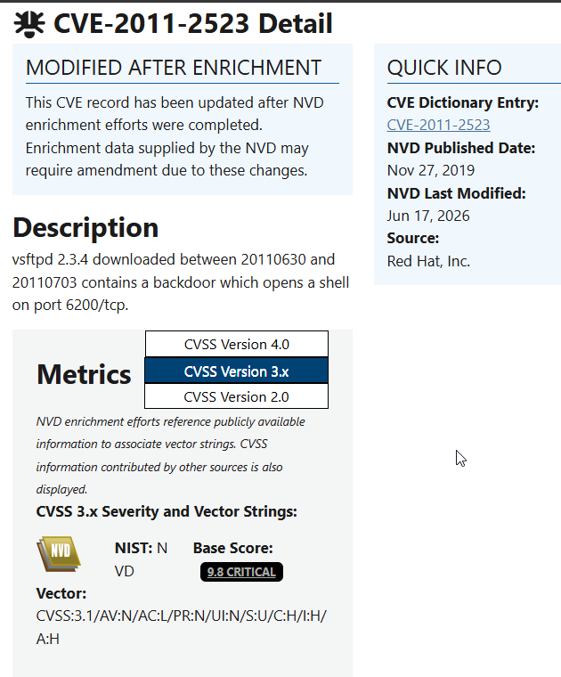

>[!note]
>Esta vulnerabilidad consiste en un <span title="Un backdoor (o puerta trasera) es un método oculto para acceder a un sistema informático saltándose los mecanismos de seguridad normales (contraseñas, autenticación, cifrado). Puede ser intencional (lo deja el propio desarrollador, por ejemplo para mantenimiento) o malicioso (lo instala un atacante tras explotar una vulnerabilidad)."><b><i>backdoor</i></b></span> con el que tras conectarse de forma inicial al servidor FTP e introduciendo cualquier usuario que termine con los caracteres `:)` y cualquier contraseña, se abre el puerto `6200` de la máquina esperando una conexión remota para una sesión como usuario ***superadministrador***.
>
>De esta forma, una amenaza puede obtener control total del sistema, de una orma rápida y muy simple.
##### `Apache httpd 2.4.58`
```bash
# SearchSploit --> 2026-11-20 11:28
searchsploit apache httpd 2.4.58

Exploits: No Results
Shellcodes: No Results
```

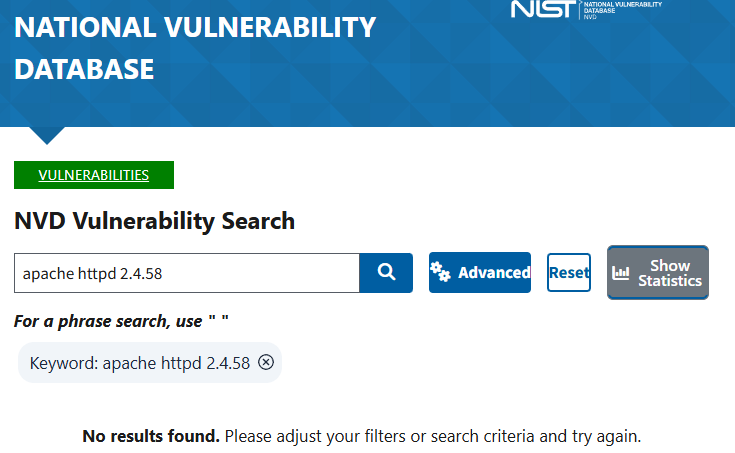

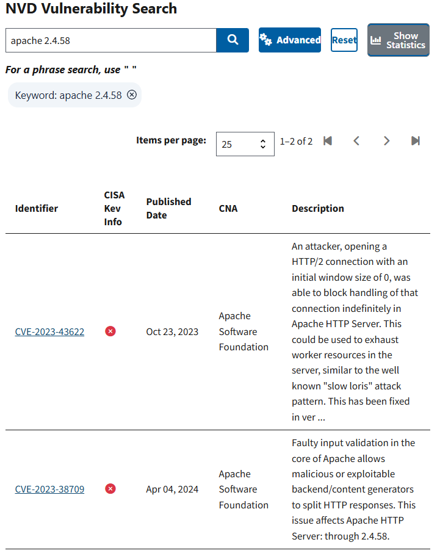
###### [`CVE-2023-38709`](https://nvd.nist.gov/vuln/detail/cve-2023-38709)
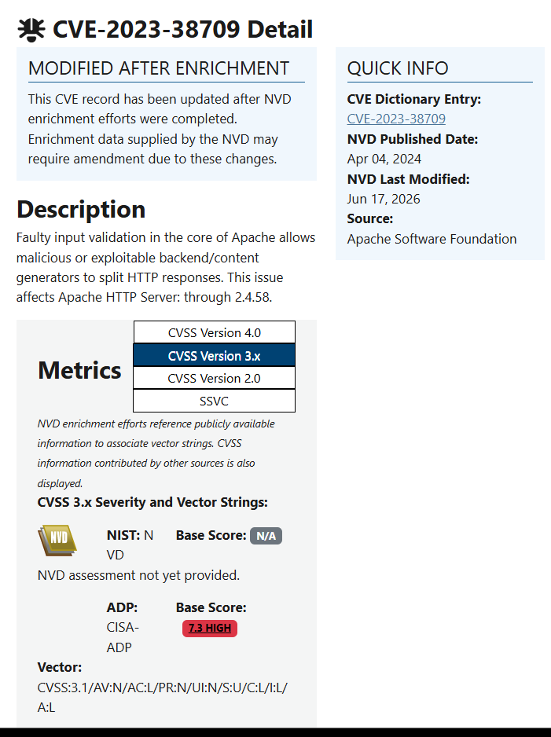

>[!note]
>La vulnerabilidad `CVE-2023-38709` afecta a todas las versiones de Apache HTTP Server hasta la `2.4.58` ***inclusive***.
>
>La vulnerabilidad radica en que el servidor no valida correctamente ciertos datos internos antes de enviarlos, lo que permite que un atacante manipule la estructura de la comunicación y logre dividir una respuesta legítima en dos, introduciendo contenido no autorizado.
#### Reconocimiento manual
##### HTTP (80)
Cuando nos conectamos al servidor web en el puerto `80`, encontramos la web por defecto de Apache para Ubuntu. Al no poder realizar técnicas intrusivas, se desconoce la existencia de *endpoints* ocultos pero accesibles de forma pública.
##### FTP
Si tratamos de acceder como el usuario `anonymous` sin contraseña se nos devuelve el siguiente error:

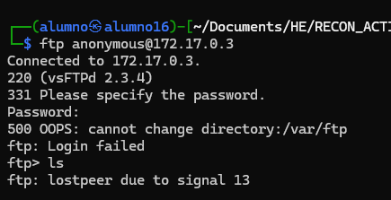

El error mostrado nos indica que el usuario `anonymous` ***si está habilitado*** en el servidor, pero el servicio se encuentra mal configurado.

---
### `172.17.0.4`

```
PORT     STATE SERVICE VERSION
22/tcp   open  ssh     OpenSSH 7.9p1 Debian 10+deb10u4 (protocol 2.0)
8009/tcp open  ajp13   Apache Jserv (Protocol v1.3)
8080/tcp open  http    Apache Tomcat 9.0.30
MAC Address: 72:83:A3:FF:A6:D3 (Unknown)
Service Info: OS: Linux; CPE: cpe:/o:linux:linux_kernel
```
#### CVE
##### `OpenSSH 7.9p1`

```bash
# SearchSploit --> 2026-11-20 12:14
searchsploit OpenSSH 7.9p1

searchsploit OpenSSH 7.9p1
Exploits: No Results
Shellcodes: No Results
```

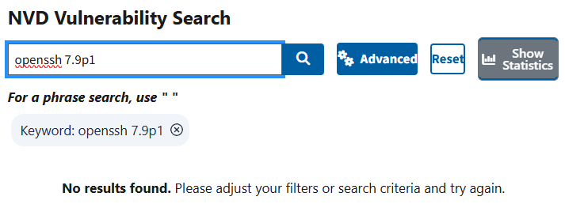

>No se identifican vulnerabilidades conocidas.
##### `Apache Jserv (Protocol v1.3)`

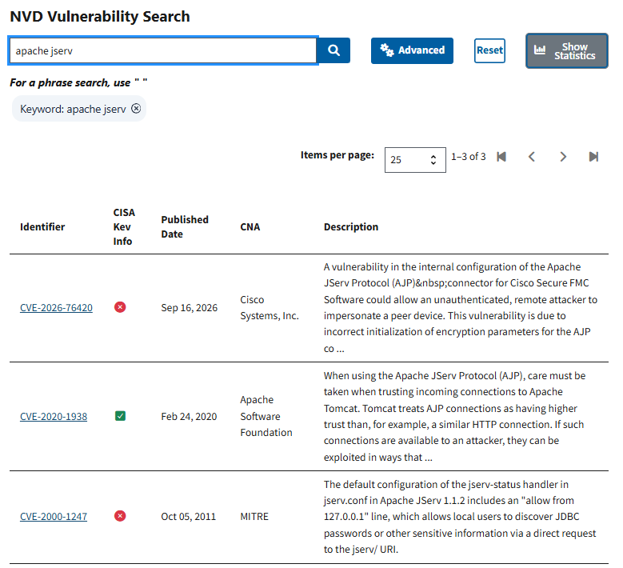

##### [`CVE-2020-1938`](https://nvd.nist.gov/vuln/detail/cve-2020-1938)

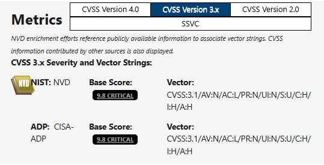

>[!note]
>El servidor Apache Tomcat (v `9.0.30`) cuenta con un canal de comunicación interno (puerto `8009 (JSP)`), diseñado originalmente para que distintos servidores de la empresa intercambien información entre sí de forma rápida. El fallo radica en que este canal se encuentra expuesto a la red y acepta peticiones sin exigir autenticación, lo que permite que un atacante externo se haga pasar por un servidor interno de confianza.
##### `Apache Tomcat 9.0.30`

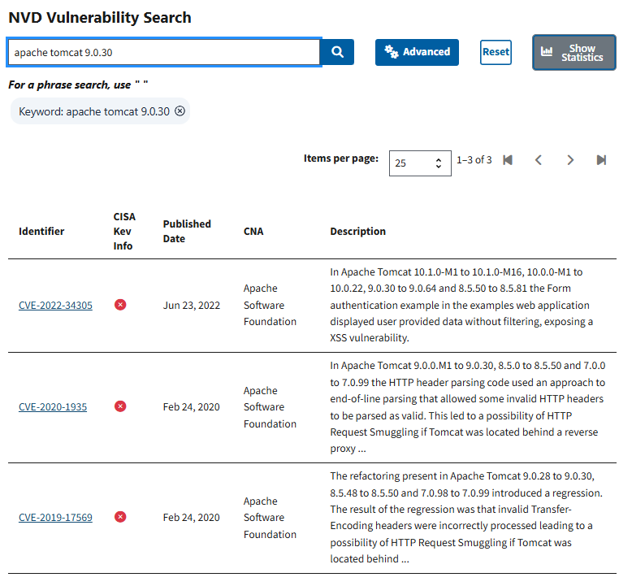
##### [`CVE-2022-34305`](https://nvd.nist.gov/vuln/detail/cve-2022-34305)

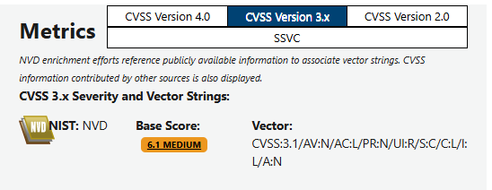

>Vulnerabilidad de severidad media clasificada como **CWE-79: Cross-Site Scripting** en la aplicación de demostración que viene instalada por defecto en Apache Tomcat (afectando a la versión 9.0.30 y otras ramas). En concreto, uno de los formularios de ejemplo muestra en pantalla los datos introducidos por el usuario sin validarlos ni filtrarlos previamente. Esto permite que un atacante diseñe un enlace malicioso capaz de ejecutar código no autorizado directamente en el navegador de la persona que lo abra.
##### [`CVE-2020-1935`](https://nvd.nist.gov/vuln/detail/cve-2020-1935)

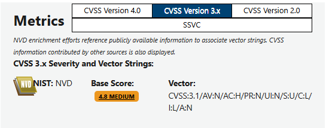

>[!note]
>El fallo ocurre porque el servidor es demasiado permisivo al leer ciertas instrucciones internas de las peticiones web, aceptando como válidos mensajes que tienen un formato incorrecto. Si el servidor opera detrás de un sistema intermediario (como un balanceador de carga o un proxy inverso) que interprete esos mismos mensajes de forma distinta, se produce una desincronización conocida como _HTTP Request Smuggling_ (contrabando de peticiones).
##### [`CVE-2019-17569`](https://nvd.nist.gov/vuln/detail/cve-2019-17569)

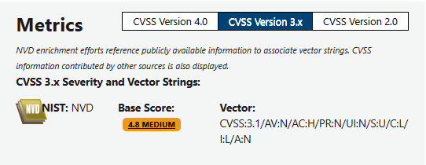

>[!note]
>Este fallo provoca que Tomcat procese de forma incorrecta ciertas peticiones web que contienen etiquetas de formato inválidas, en lugar de rechazarlas. Cuando el servidor trabaja detrás de un sistema intermediario (como un proxy inverso o balanceador de carga) que interpreta ese mismo error de forma diferente, se abre la puerta a un ataque de _HTTP Request Smuggling_ (contrabando de peticiones).

---
### `172.17.0.5`

```
PORT      STATE SERVICE    VERSION
80/tcp    open  http       Apache httpd 2.4.59 ((Debian))
443/tcp   open  ssl/http   Apache httpd 2.4.59 ((Debian))
1883/tcp  open  mqtt
5672/tcp  open  amqp?
8161/tcp  open  http       Jetty 9.4.39.v20210325
39789/tcp open  tcpwrapped
61613/tcp open  stomp      Apache ActiveMQ
61614/tcp open  http       Jetty 9.4.39.v20210325
61616/tcp open  apachemq   ActiveMQ OpenWire transport 5.15.15
```
#### CVE
##### `HTTP (80)`

```bash
# SearchSploit --> 2026-11-20 13:04
searchsploit Apache httpd 2.4.59

Exploits: No Results
Shellcodes: No Results
```

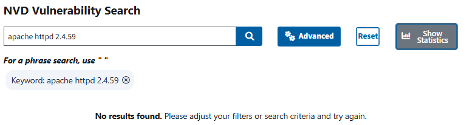
##### `Jetty 9.4.39.v20210325`

```bash
# SearchSploit --> 2026-11-20 13:10
searchsploit jetty 9.4.39

Exploits: No Results
Shellcodes: No Results
```

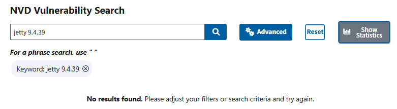
##### `ActiveMQ OpenWire transport 5.15.15`

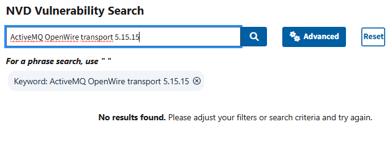
#### Reconocimiento manual
##### HTTP (80)
Al acceder al servidor en el puerto `80` encontramos la página por defecto para las máquinas Debian. Al no poder realizar técnicas intrusivas, se desconoce la existencia de *endpoints* ocultos pero accesibles de forma pública.
##### HTTPS (443)
Cuando tratamos de acceder al servidor HTTPS en el puerto `443` encontramos un error de *Entidad Certificadora inválida*. Si miramos la información del certificado nos damos cuenta de que este error ocurre debido a que el certificado a sido ***autofirmado***, y además está caducado desde el `2025-04-17`.

Si seguimos adelante con la conexión, encontramos una aplicación web de un restaurante. La aplicación parece estar en ***desarrollo***, por lo que tenerlo accesible a través de la red es un riesgo de seguridad, ya que posiblemente durante el desarrollo hayan fugas de información como *API-KEYS*, comentarios para desarrolladores, etc.
###### Dependencias
Se han analizado las posibles vulnerabilidades de las dependencias de la aplicación web.

- `jQuery (3.4.1)`:
	- `CVE-2020-11023`: El fallo ocurre cuando una página web procesa contenido HTML procedente de fuentes externas que incluye ciertos elementos específicos (como etiquetas de listas desplegables). Debido a un error en la forma en que jQuery interpreta estos datos, un atacante puede lograr que se ejecute código malicioso oculto en el navegador de los usuarios, incluso si la aplicación intenta filtrar o limpiar esa información previamente.
	- `CVE-2020-11022`: El fallo reside en la forma en que jQuery procesa y modifica fragmentos de código HTML procedentes de fuentes externas: debido a un error en su interpretación interna, un atacante puede introducir código malicioso que se ejecuta en el navegador del usuario, logrando burlar incluso los filtros de limpieza de datos que la aplicación web haya aplicado previamente.

- `BootStrap (4.3.1)`: Esta versión de ***BootStrap*** ya no recibe parches de seguridad y tiene algunas posibles vulnerabilidades. Se recomienda migrar a ***Bootstrap 5.x*** o, si se necesita seguir en `4.x` por compatibilidad, **HeroDevs** ofrece parches de seguridad extendidos.
##### HTTP (8161)
Al tratar de acceder, se nos muestra un cuadro de diálogo de ***Autenticación HTTP*** (*HTTP Authentication*), seguramente por ***Autenticación Básica HTTP***.

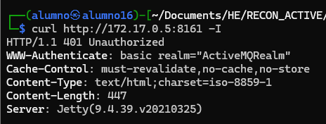

En las cabeceras de respuestas del servicio encontramos que el servidor que usa es ***Jetty 9.4.39.v20210325)***.

>[!important]
>El puerto `8161` suele corresponder por defecto a la consola web de ***Apache ActiveMQ***, la cual usa *HTTP Basic Auth*.
>
>Por lo que podemos asumir que este puerto corresponde a la consola web de ***Apache ActiveMQ***.

>*No se ha seguido el reconocimiento para no usar técnicas intrusivas que se salgan del Scope definido.*
##### HTTP (61614)
El conectarnos a este puerto a través de un navegador recibimos una web en blanco. Si realizamos la petición `GET` a través de `curl`, obtenemos que la conexión ha sido exitosa, aunque no devuelve nada.

```bash
# curl --> 2026-11-20 14:15
curl http://172.17.0.5:61614 -i

HTTP/1.1 200 OK
Date: Fri, 20 Nov 2026 13:10:23 GMT
Content-Length: 0
Server: Jetty(9.4.39.v20210325)
```

---
### `172.17.0.6`

```
PORT     STATE SERVICE VERSION
22/tcp   open  ssh     OpenSSH 9.2p1 Debian 2+deb12u2 (protocol 2.0)
8080/tcp open  http    Jetty 10.0.18
MAC Address: 3A:0D:4E:B3:B3:92 (Unknown)
Service Info: OS: Linux; CPE: cpe:/o:linux:linux_kernel
```
#### CVE
##### `OpenSSH 9.2p1`

```bash
# SearchSlpoit --> 2026-11-20 14:23
searchsploit openssh 9.2p1

Exploits: No Results
Shellcodes: No Results
```

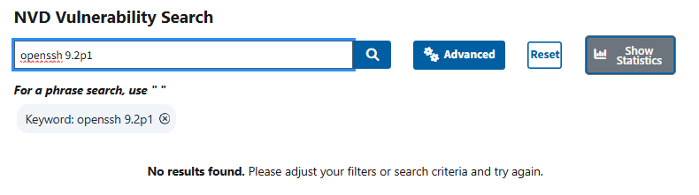
##### `Jetty 10.0.18`

```bash
# SearchSlpoit --> 2026-11-20 14:25
searchsploit jetty 10.0.18

Exploits: No Results
Shellcodes: No Results
```

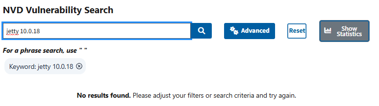
#### Reconocimiento manual
##### HTTP (8080)
Al conectarnos al servidor web Jetty, nos encontramos con un panel de Login de ***Jenkins***. Se detectó la versión `2.441` de ***Jenkins***, y se buscaron vulnerabilidades conocidas:

```bash
# SearchSlpoit --> 2026-11-20 14:31
searchsploit jenkins 2.441

Jenkins 2.441 - Local File Inclusion     | java/webapps/51993.py
```

![img]../(img/jenkins_2.441_cve.png)
###### [`CVE-2024-23897`](https://nvd.nist.gov/vuln/detail/cve-2024-23897)

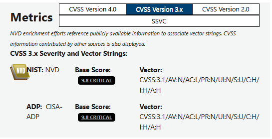

>[!note]
>El fallo reside en la forma en que su interfaz de línea de comandos (CLI) interpreta los argumentos enviados en una petición: al utilizar una librería interna con una función de expansión de argumentos (`args4j`), el sistema reemplaza ciertos caracteres especiales (como `@` seguido de una ruta de archivo) por el contenido real de archivos locales en el servidor donde se ejecuta Jenkins.
###### [`CVE-2024-23898`](https://nvd.nist.gov/vuln/detail/cve-2024-23898)
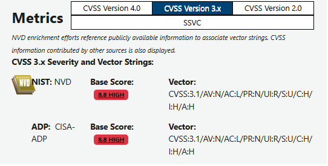

>[!note]
>El fallo ocurre en el canal de comunicación en tiempo real (WebSocket) que utiliza su interfaz de línea de comandos (CLI), ya que el servidor no comprueba adecuadamente desde qué sitio web se origina la conexión. Como consecuencia, si un usuario que tiene sesión iniciada en Jenkins visita una página web maliciosa, esa página puede abrir una conexión en su nombre y enviar órdenes a Jenkins aprovechando su sesión activa (_Cross-Site WebSocket Hijacking_).

---
### `172.17.0.7`

```
PORT   STATE SERVICE VERSION
22/tcp open  ssh     OpenSSH 7.7 (protocol 2.0)
MAC Address: 3E:8E:8B:DE:39:B7 (Unknown)
```
#### CVE
##### `OpenSSH 7.7`

```bash
# Searchsploit --> 2026-11-21 19:10
searchsploit openssh 7.7

OpenSSH 2.3 < 7.7 - Username Enumeration          | linux/remote/45233.py
OpenSSH 2.3 < 7.7 - Username Enumeration (PoC)    | linux/remote/45210.py
OpenSSH < 7.7 - User Enumeration (2)              | linux/remote/45939.py
```

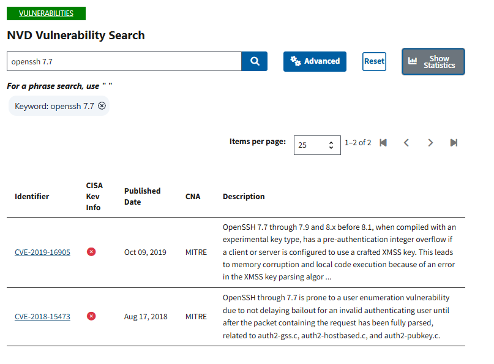
###### [`CVE-2019-16905`](https://nvd.nist.gov/vuln/detail/cve-2019-16905)
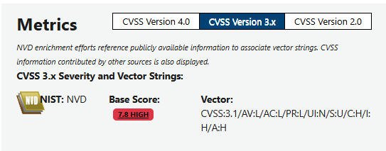

>[!note]
>El fallo ocurre en el algoritmo encargado de procesar un tipo de clave criptográfica experimental (**XMSS**): al analizar una clave manipulada, se produce un desbordamiento numérico que provoca corrupción de memoria. Es importante destacar que esta función es experimental y no viene habilitada de forma estándar en las compilaciones habituales de OpenSSH.
###### [`CVE-2018-15473`](https://nvd.nist.gov/vuln/detail/CVE-2018-15473)
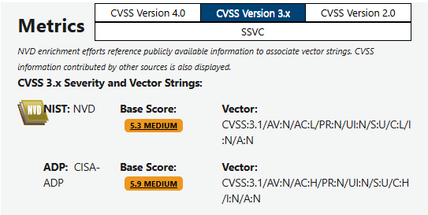

>[!note]
>El fallo reside en la forma en que el servidor gestiona las peticiones de autenticación de usuarios: al comprobar si un nombre de usuario existe, el sistema responde de manera ligeramente distinta dependiendo de si la cuenta es válida o no (por ejemplo, devolviendo mensajes o respuestas diferentes ante solicitudes de autenticación malformadas). Esto permite que un atacante externo pueda verificar de forma remota qué usuarios existen en el servidor sin necesidad de conocer sus contraseñas (_User Enumeration_).

---
### `172.17.0.8`

```
PORT    STATE SERVICE     VERSION
22/tcp  open  ssh         OpenSSH 9.6p1 Ubuntu 3ubuntu13.5 (Ubuntu Linux; protocol 2.0)
80/tcp  open  http        Apache httpd 2.4.58 ((Ubuntu))
139/tcp open  netbios-ssn Samba smbd 4
445/tcp open  netbios-ssn Samba smbd 4
MAC Address: DA:41:B3:D0:CB:9D (Unknown)
Service Info: OS: Linux; CPE: cpe:/o:linux:linux_kernel
```
#### CVE
##### `OpenSSH 9.6p1`

```bash
# SearchSploit --> 2026-11-21 19:21
searchsploit openssh 9.6

Exploits: No Results
Shellcodes: No Results
```

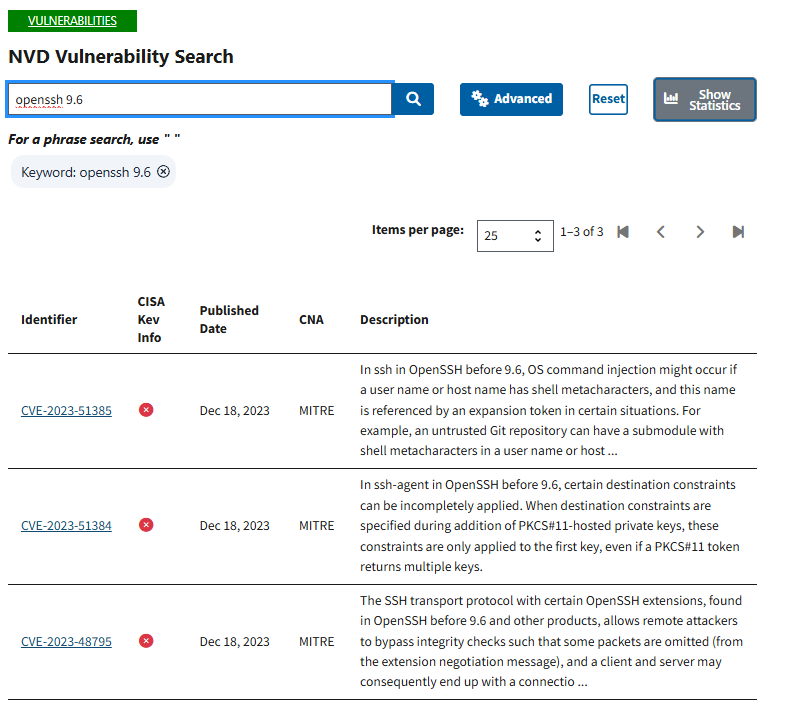

>Todas las vulnerabilidades se solucionan en la versión `9.6`. Por lo que el servicio no se ve afectado por ellas.
##### `Apache httpd 2.4.58`

```bash
# SearchSploit --> 2026-11-21 20:04
searchsploit apache httpd 2.4.58

Exploits: No Results
Shellcodes: No Results
```


###### [`CVE-2023-38709`](https://nvd.nist.gov/vuln/detail/cve-2023-38709)


>[!note]
>La vulnerabilidad `CVE-2023-38709` afecta a todas las versiones de Apache HTTP Server hasta la `2.4.58` ***inclusive***.
>
>La vulnerabilidad radica en que el servidor no valida correctamente ciertos datos internos antes de enviarlos, lo que permite que un atacante manipule la estructura de la comunicación y logre dividir una respuesta legítima en dos, introduciendo contenido no autorizado.
##### `Samba smbd 4`

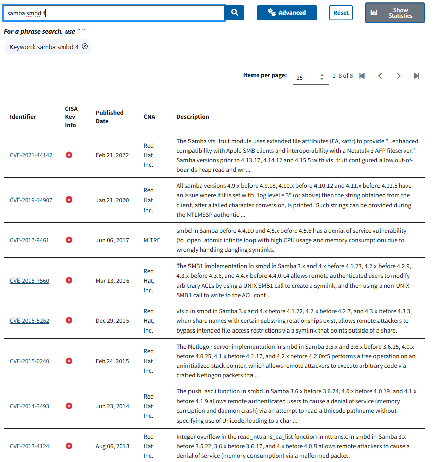
###### [`[CVE-2021-44142`](https://nvd.nist.gov/vuln/detail/CVE-2021-44142)
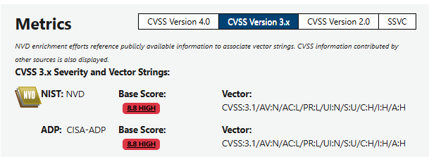

>[!note]
>El fallo afecta específicamente al módulo `vfs_fruit` (empleado para mejorar la compatibilidad con equipos Apple) cuando procesa metadatos o atributos extendidos al abrir archivos. Si el módulo está habilitado y un usuario con permisos de escritura sobre atributos extendidos envía datos manipulados, puede provocar corrupción de memoria.
###### [`CVE-2019-14907`](https://nvd.nist.gov/vuln/detail/CVE-2019-14907)
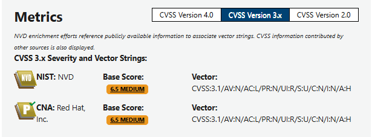

>[!note]
>El fallo ocurre cuando el servidor está configurado con un nivel de registro (`log level`) igual o superior a 3 y al procesar cadenas de texto enviadas por el cliente durante el intercambio de autenticación NTLMSSP que provocan un fallo de conversión de caracteres. Al intentar registrar o imprimir dicha cadena tras el error de conversión, se produce una lectura fuera de límites de memoria que puede provocar la caída de procesos de larga duración, como el servidor RPC en un controlador de dominio de Active Directory con Samba.
###### [`CVE-2017-9461`](https://nvd.nist.gov/vuln/detail/CVE-2017-9461)
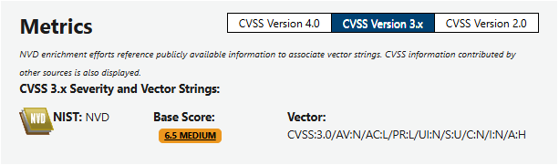

>[!note]
>El fallo ocurre en el proceso `smbd` (función `fd_open_atomic`) al gestionar de forma incorrecta enlaces simbólicos rotos (_dangling symlinks_) cuando se intenta abrir un archivo con la bandera `O_CREAT`. Un cliente autenticado con acceso al recurso compartido puede provocar que el demonio entre en un bucle infinito, disparando el consumo de CPU y memoria y degradando o interrumpiendo la disponibilidad del servicio.
###### [`CVE-2015-7560`](https://nvd.nist.gov/vuln/detail/CVE-2015-7560)
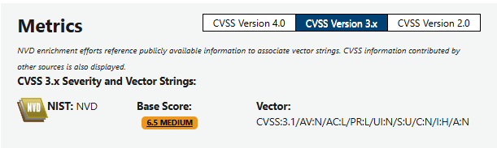

>[!note]
>El fallo reside en la implementación del protocolo SMB1 en el demonio `smbd`: un usuario remoto autenticado puede crear un enlace simbólico (_symlink_) mediante una llamada UNIX de SMB1 y, posteriormente, utilizar una llamada no UNIX de SMB1 para sobrescribir la ACL del archivo o directorio de destino al que apunta dicho enlace, logrando alterar permisos o eludir restricciones de acceso sobre recursos arbitrarios.
###### [`CVE-2015-5252`](https://nvd.nist.gov/vuln/detail/CVE-2015-5252)
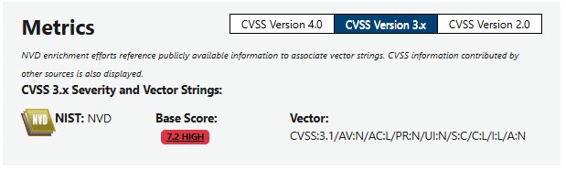

>[!note]
>El fallo reside en la gestión de rutas del demonio `smbd` (`vfs.c`), que no valida de forma adecuada los enlaces simbólicos (_symlinks_) cuando existen recursos compartidos con ciertas relaciones de subcadenas en sus nombres o rutas. Esto permite que un atacante remoto aproveche un enlace simbólico para eludir las restricciones de acceso y leer o manipular archivos ubicados fuera del directorio del recurso compartido.

###### [`CVE-2015-0240`](https://nvd.nist.gov/vuln/detail/CVE-2015-0240)
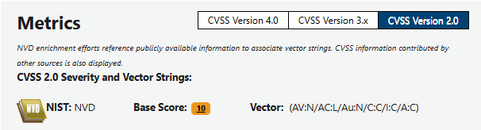

>[!note]
>El fallo reside en la función `_netr_ServerPasswordSet` del servicio Netlogon dentro del demonio `smbd`: al procesar una petición RPC especialmente manipulada, el servidor intenta liberar memoria (`free()`) utilizando un puntero de la pila que no ha sido inicializado previamente. Esto permite que un atacante remoto, sin necesidad de autenticarse, corrompa la memoria del proceso y logre ejecutar código arbitrario con privilegios de `root` o provocar la caída del servicio.
###### [`CVE-2014-3493`](https://nvd.nist.gov/vuln/detail/CVE-2014-3493)
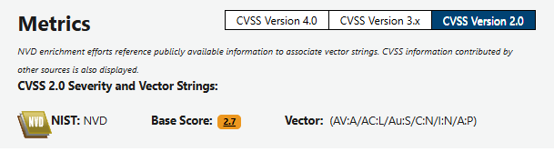

>[!note]
>El fallo reside en la función `push_ascii` del demonio `smbd`: cuando un usuario remoto autenticado intenta leer una ruta de archivo en formato Unicode sin especificar el uso de Unicode en su petición, se produce un error en la conversión del juego de caracteres que desencadena una desreferencia de puntero no válido, provocando corrupción de memoria y la caída del servicio.
###### [`CVE-2013-4124`](https://nvd.nist.gov/vuln/detail/CVE-2013-4124)
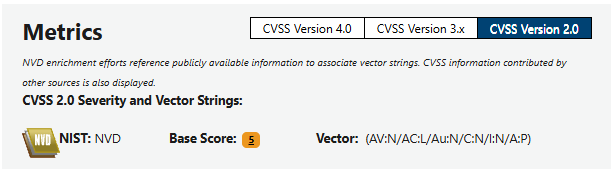

>[!note]
>El fallo reside en la función `read_nttrans_ea_list` del demonio `smbd` (`nttrans.c`): al procesar una lista de atributos extendidos (_Extended Attributes_) especialmente manipulada dentro de una petición SMB, se produce un desbordamiento de enteros. Esto permite que un atacante remoto provoque un consumo excesivo de memoria y CPU, derivando en la caída o inoperatividad del servicio.
#### Reconocimiento manual
##### HTTP (80)
Al entrar en la web vemos un panel de inicio de sesión de una aplicación web. No podemos sacar demasiado con lo que vemos sin iniciar sesión.
##### Samba (445)
Cuando vemos el contenido compartido de forma pública, vemos lo siguiente:

```bash
# smbclient --> 2026-11-21 22:40
smbclient -L //172.17.0.8 -N
```

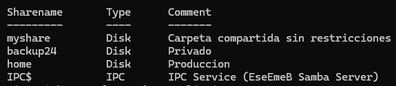

El listado muestra cuatro recursos expuestos por el servidor Samba, tres de tipo disco y uno administrativo:
- `myshare` **(Disk - Carpeta compartida sin restricciones)**
- `backup24` **(Disk - Privado)***
- `home` **(Disk - Producción)**
- `$IPC` **(IPC - IPC Service (EseEmeB Samba Server)):** Recurso estandar de comunicación entre procesos (*Inter-Process Communication*) de SMB, no una carpeta de archivos.
###### `myshare`

```bash
# smbclient --> 2026-11-21 22:42
smbclient //172.17.0.8/myshare -N -c 'ls'

access.txt        N    956  Sun Oct  6 06:46:26 2024
```

>[!warning]
>*Encontramos un archivo `access.txt` con posible información sensible.*
###### `backup24`

```bash
# smbclient --> 2026-11-21 22:42
smbclient //172.17.0.8 -N -c 'ls'

Anonymous login successful
tree connect failed: NT_STATUS_ACCESS_DENIED
```

La salida nos indica que el servidor si admite sesiones anónimas, pero que este recurso se encuentra protegido y no podemos acceder a él.
###### `home`

```bash
# smbclient --> 2026-11-21 22:57
smbclient //172.17.0.8 -N -c 'ls'

Anonymous login successful
tree connect failed: NT_STATUS_ACCESS_DENIED
```

Tampoco podemos acceder a este recurso sin credenciales.
###### `$IPC`
Sabiendo que el servidor acepta sesiones nulas. Tratamos de enumerar información del sistema a través de `$IPC`:

```bash
# rpcclient · Enumeración de usuarios del sistema --> 2026-11-21 23:11
rpcclient -N -U '' 172.17.0.8 -c 'querydispinfo; enumdomusers'

index: 0x1 RID: 0x3e8 acb: 0x00000010 Account: usuario1 Name:   Desc:
index: 0x2 RID: 0x3ea acb: 0x00000010 Account: usuario3 Name:   Desc:
index: 0x3 RID: 0x3ec acb: 0x00000010 Account: administrador    Name:   Desc:
index: 0x4 RID: 0x3e9 acb: 0x00000010 Account: usuario2 Name:   Desc:
index: 0x5 RID: 0x3eb acb: 0x00000010 Account: satriani7        Name:   Desc:
user:[usuario1] rid:[0x3e8]
user:[usuario3] rid:[0x3ea]
user:[administrador] rid:[0x3ec]
user:[usuario2] rid:[0x3e9]
user:[satriani7] rid:[0x3eb]
```

Se confirma un hallazgo de **enumeración anónima de usuarios mediante sesión nula en SMB/RPC** en el equipo `172.17.0.8`. El servidor permitió consultar el servicio SAMR sin credenciales y devolvió cinco cuentas de usuario válidas:
- `administrador` (RID `0x3ec`): Cuenta administrativa con potencial alto nivel de privilegios.
- `striani7` (RID `0x3eb`): Cuenta personal.
- `usuario1` (RID `0x3e8`), `usuario2` (RID `0x3e9`) y `usuario 3` (RID `0x3ea`): Posibles cuentas genéricas.

>Todas las cuentas aparecen con la *flag* `acb: 0x00000010` (cuentas de usuario normales activas) y no exponen información adicional en los campos `Name` ni `Desc`.

```bash
# rpcclient · Enumerar grupos y políticas de contraseñas --> 2026-11-21 23:22
rpcclient -N -U '' 172.17.0.8 -c 'enumdomgroups;getdompwinfo'

min_password_length: 5
password_properties: 0x00000000
```

La salida confirma una ***política de contraseñas débil*** expuesta de forma anónima en el servidor `172.17.0.8`:
- `enumdomgroups` **(Sin salida)**
- `min_password_length: 5`: La longitud mínima exigida para las contraseñas es de solo 5 caracteres (el valor por defecto en Samba, muy por debajo de los estándares recomendados de 12–14 caracteres).
- `password_properties: 0x00000000`: No hay requisitos de complejidad habilitados (permite contraseñas sin mayúsculas, números ni símbolos).
###### Seguridad del protocolo
```bash
# nmap · Scripts NSE NO intrusivos --> 2026-11-21 23:36
nmap -Pn -n -p 445 --script smb-protocols,smb-security-mode,smb2-security-mode,smb2-capabilities 172.17.0.8
```

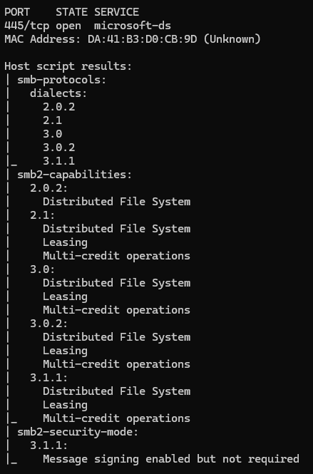

- `smb-protocols`: El servidor no acepta SMBv1.
- `smb2-security-mode` (`Message signing enabled but not required`): Permite ataques *SMB Relay* o *Man-in-the-Middle* en la red local.
- `smb2-cpabilities`: Sin cifrado.
###### Metadatos adicionales por RPC
```bash
# rpcclient · Info del servidor y SID de la máquina --> 2026-11-21 23:45
rpcclient -N -U '' 172.17.0.8 -c 'srvinfo; lsaquery'

SAMBASERVER    Wk Sv PrQ Unx NT SNT EseEmeB Samba Server
platform_id     :       500
os version      :       6.1
server type     :       0x809a03
Domain Name: ESEEMEB.DL
Domain Sid: (NULL SID)
```

- **Nombre del servidor y banner:** Se identifica como `SAMBASERVER` con la descripción `EseEmeB Samba Server`.
- **Confirmación de sistema Unix/Linux:** El indicador `Unx` en las capacidades del servidor (`Wk Sv PrQ Unx NT SNT`) confirma que se trata de un sistema Unix/Linux ejecutando Samba.
	- Los valores `platform_id: 500` y `os version: 6.1` son la emulación estándar que anuncia Samba para mantener compatibilidad con clientes Windows.
- **Grupo de trabajo / Dominio:** `ESEEMEB.DL`
- **Rol del servidor** (`Domain Sid: (NULL SID)`): Al devolver un SID nulo, queda confirmado que el equipo opera como servidor independiente (_standalone_) dentro de un grupo de trabajo y no como controlador de dominio.
###### Detalles individuales de las cuentas descubiertas
```bash
# rpcclient · Detalles individuales de cuenta --> 2026-11-21 23:53
rpcclient -N -U '' 172.17.0.8 -c 'queryuser RID'

# Automatización con script
for cod_user in $(awk '{print $4}' temp.txt); do
	rpcclient -N -U '' 172.17.0.8 -c "queryuser $cod_user" > "$cod_user"_info.txt
done
```

Ahora tenemos 5 archivos con información de los 5 usuarios del sistema.
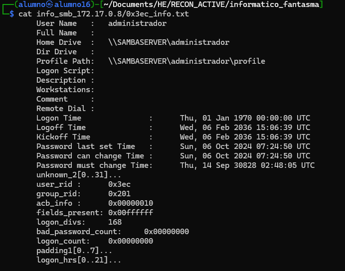
###### Metadatos extendidos de los recursos compartidos
```bash
# rpcclient · Metadatos extendidos de recursos compartidos --> 2026-11-22 0:17
rpcclient -N -U '' 172.17.0.8 -c 'netshareenum; netshareenumall'
```

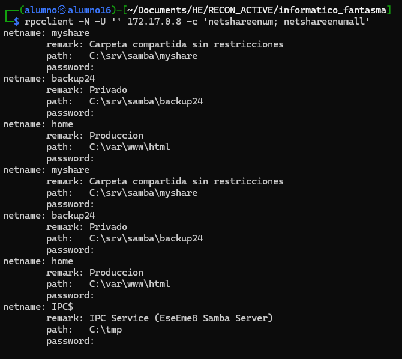

>[!warning]
>El servidor está exponiendo de forma anónima las **rutas internas reales del sistema de archivos Linux** asociadas a cada recurso compartido.
> - **`myshare`** (_Carpeta compartida sin restricciones_) → `/srv/samba/myshare`
>- **`backup24`** (_Privado_) → `/srv/samba/backup24`
>- **`home`** (_Produccion_) → **`/var/www/html`**
>- **`IPC$`** (_IPC Service (EseEmeB Samba Server)_) → `/tmp`
##### Netbios (139)
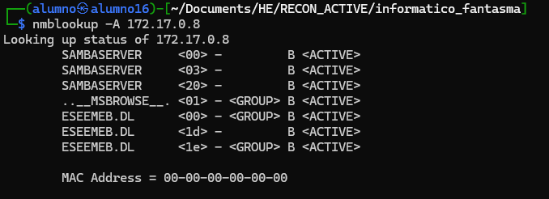

>El puerto `139` abierto junto al `445` en un servidor moderno representa normalmente una superficie de ataque innecesaria.

---
### `172.17.0.9`

```
PORT   STATE SERVICE VERSION
22/tcp open  ssh     OpenSSH 9.2p1 Debian 2+deb12u10 (protocol 2.0)
80/tcp open  http    Apache httpd 2.4.68 ((Debian))
MAC Address: 06:FE:85:80:3E:A0 (Unknown)
```
#### CVE
##### `OpenSSH 9.2p1`

```bash
# SearchSlpoit --> 2026-11-20 14:23
searchsploit openssh 9.2p1

Exploits: No Results
Shellcodes: No Results
```


##### `Apache httpd 2.4.68`

```bash
# SearchSploit --> 2026-11-22 12:39
searchsploit apache httpd 2.4.68

Exploits: No Results
Shellcodes: No Results
```


>La única vulnerabilidad se soluciona en la versión `2.4.68`. Por lo que no nos afecta.
#### Reconocimiento manual
##### HTTP (80)
```bash
# whatweb --> 2026-11-22 12:59
whatweb http://172.17.0.9

http://172.17.0.9 [200 OK] Apache[2.4.68], Country[RESERVED][ZZ], HTML5, HTTPServer[Debian Linux][Apach/2.4.68 (Debian)], IP[172.17.0.9], Title[test page]
```

Encontramos una aplicación web bajo desarrollo, la cual no nos da muchas pistas. Encontramos un panel de "*Login*" que muestra el *endpoint* `login.php` encargado de procesar las credenciales. Ni el código fuente HTML ni las hojas de estilo CSS filtran algún tipo de información sensible.

---
### `172.17.0.10`

```
PORT   STATE SERVICE VERSION
80/tcp open  http    SimpleHTTPServer 0.6 (Python 3.11.2)
MAC Address: 12:4F:2B:31:4F:86 (Unknown)
```
#### CVE
##### `SimpleHTTPServer 0.6 (Python 3.11.2)`

```bash
# SearchSploit --> 2026-11-22 13:25
searchsploit simplehttpserver 0.6

Exploits: No Results
Shellcodes: No Results
```

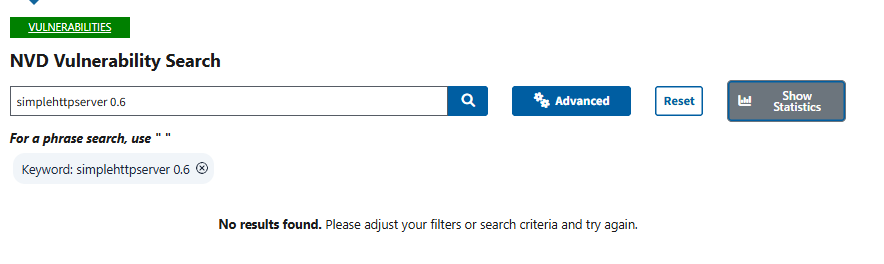

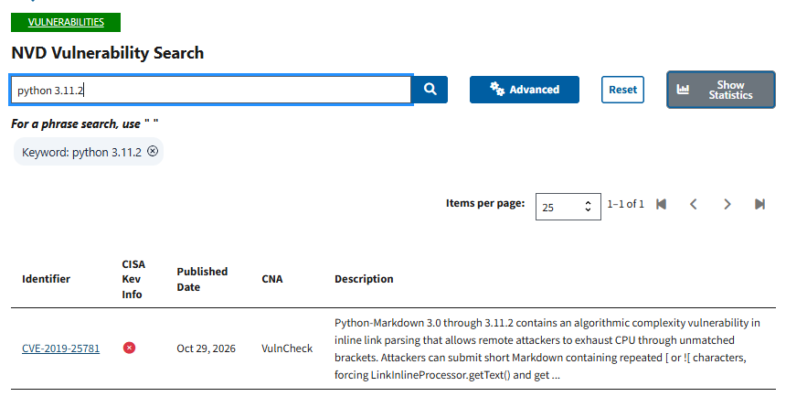
###### [`CVE-2019-25781`](https://nvd.nist.gov/vuln/detail/CVE-2019-25781)
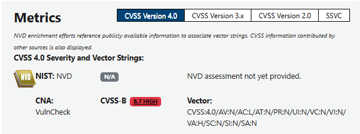

>[!note]
>El fallo reside en el análisis de enlaces en línea dentro de los métodos `LinkInlineProcessor.getText()` y `getLink()`: cuando un atacante remoto envía texto Markdown corto que contiene secuencias repetidas de corchetes sin cerrar (`[` o `![`), el analizador se ve forzado a realizar escaneos de complejidad cuadrática. Esto provoca un consumo excesivo de CPU que mantiene bloqueados los procesos (_workers_) durante minutos, pudiendo degradar el rendimiento del servidor o dejar el servicio completamente inaccesible.
#### Reconocimiento manual
##### `SimpleHTTPServer 0.6 (80)`
```bash
# whatweb --> 2026-11-22 13:33
whatweb http://172.17.0.10

http://172.17.0.10 [200 OK] Country[RESERVED][ZZ], HTML5, HTTPServer[SimpleHTTP/0.6 Python/3.11.2], IP[172.17.0.10], Python[3.11.2], Title[CTG · IPMI bajo exposición
```

Cuando vemos la web descubrimos que es un laboratorio de pruebas para un estándar de gestión remota de servidores denominada `IPMI (Intelligent Paltform Managment Interface)`. Nos muestra el puertos sobre el que corre (`623/UDP`) y conceptos como `BMC (Baseboard Managment Controller)` o `SOL (Serial Over LAN)`. Además, se nos muestra una vulnerabilidad `CVE-2013-4786`.

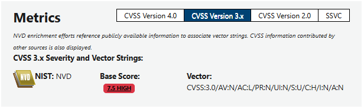

>[!note]
>Durante el inicio de sesión contra el controlador de gestión de placa base (_BMC_), el protocolo incluye el hash (HMAC) derivado de la contraseña del usuario en la respuesta _RAKP Message 2_. Esto permite a un atacante remoto solicitar y capturar dichos hashes sin necesidad de autenticarse previamente, para después realizar ataques de fuerza bruta o diccionario de forma _offline_ con el objetivo de obtener las contraseñas en texto claro y comprometer el control administrativo del hardware del servidor.
##### `IPMI (623/UDP`
```bash
# nmap · Identificación de versión --> 2026-11-22 13:53
sudo nmap -Pn -n -sU --script ipmi-version -p623 172.17.0.10

PORT    STATE SERVICE
623/udp open  asf-rmcp
| ipmi-version:
|   Version:
|     IPMI-2.0
|   UserAuth: password, md5, md2, null
|   PassAuth: auth_msg, auth_user, non_null_user
|_  Level: 1.5, 2.0
MAC Address: 12:4F:2B:31:4F:86 (Unknown)
```
###### Exposición al fallo de IPMI 2.0 (`CVE-2013-4786`)
- **Evidencia:** El servicio anuncia soporte para `IPMI-2.0` (`Level: 1.5, 2.0`).
- **Riesgo:** Al estar activo IPMI 2.0 y ser accesible por red, el controlador BMC es vulnerable por diseño a la obtención de hashes HMAC mediante _RAKP Message 2_ (**CVE-2013-4786**), lo que permite ataques de fuerza bruta _offline_ contra las contraseñas administrativas.
###### Compatibilidad con protocolo heredado (IPMI 1.5)
- **Evidencia:** El campo `Level` incluye la versión **`1.5`**.
- **Riesgo:** IPMI 1.5 es un protocolo obsoleto que carece de cifrado moderno y presenta graves debilidades de autenticación.
###### Métodos de autenticación débiles habilitados
- **Evidencia:** En `UserAuth` el servidor anuncia soporte para **`password`**, **`md5`**, **`md2`** y **`null`**.
- **Riesgo:** Permitir autenticación en texto plano (`password`), algoritmos criptográficos rotos (`md2`, `md5`) o sesiones sin autenticación (`null`) debilita gravemente el control de acceso al hardware. (Aunque `PassAuth` indica `non_null_user` —es decir, que existen cuentas con nombre de usuario definido—, mantener habilitados estos métodos en el servicio supone una mala práctica de endurecimiento).
